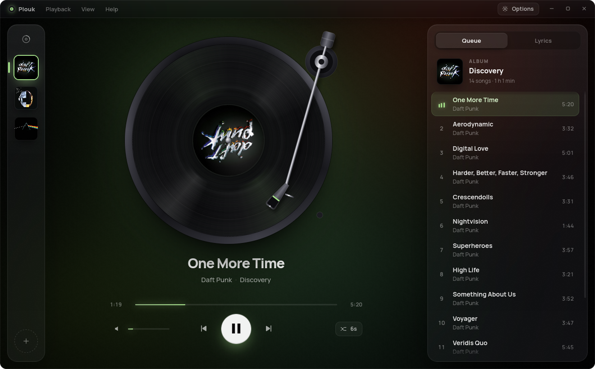
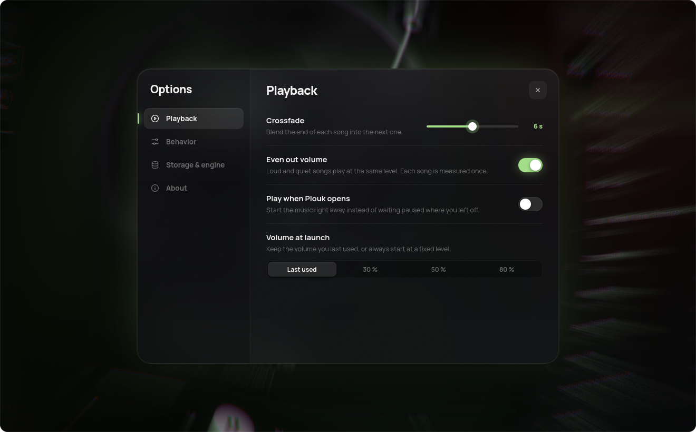
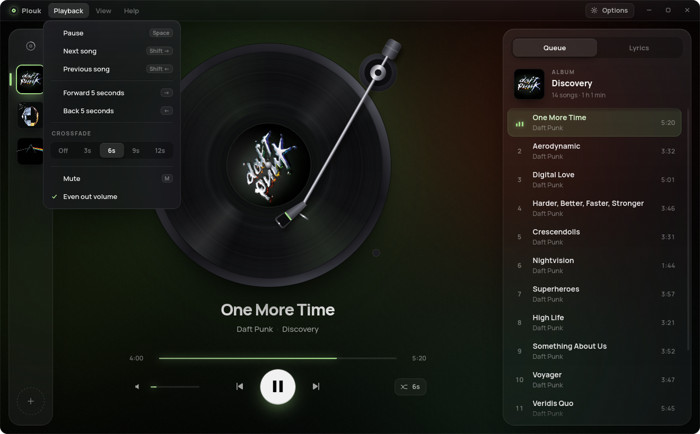
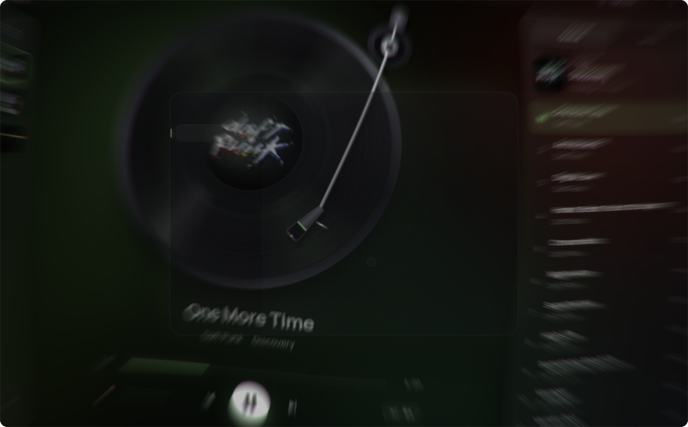
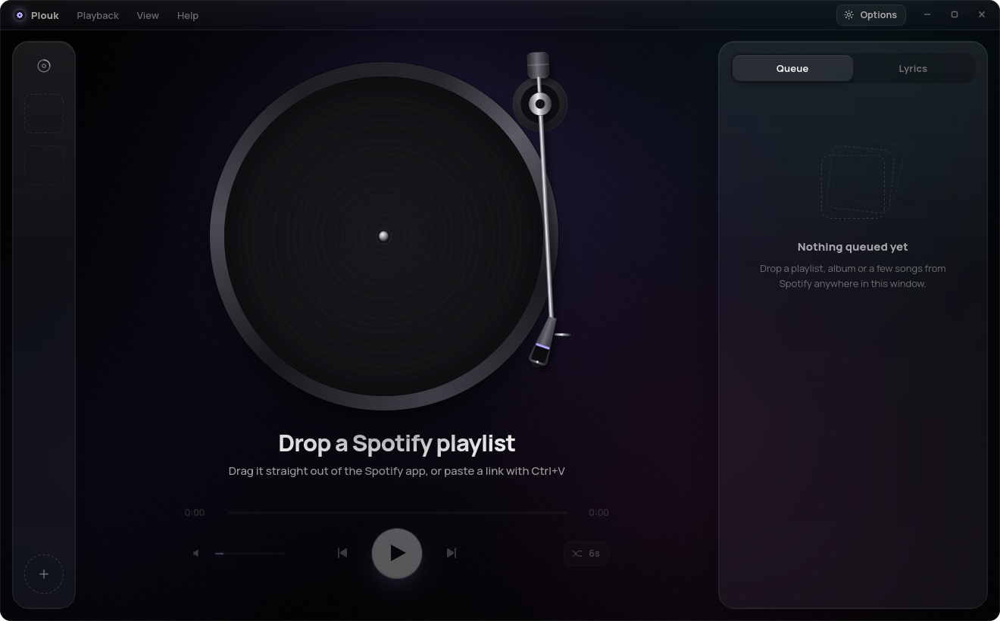
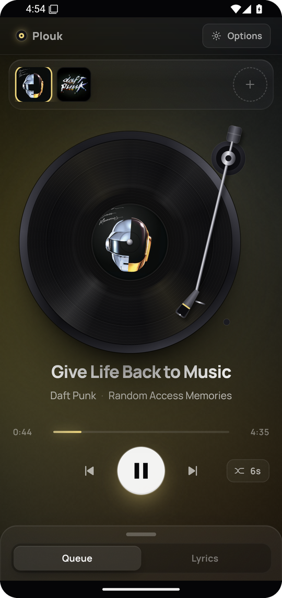
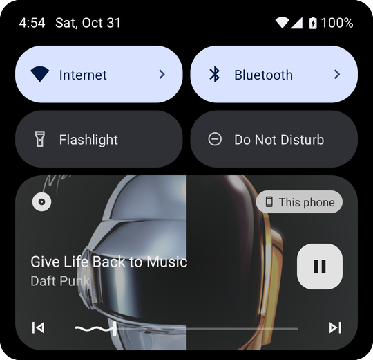

<p align="center">
  <picture>
    <source media="(prefers-color-scheme: dark)" srcset="docs/brand/ehs-logo-dark.svg">
    
  </picture>
</p>

<h1 align="center">Plouk</h1>

<p align="center">
  A little record player for Linux, macOS and Android.<br>
  Drag a playlist out of Spotify (or share it to Plouk on your phone), and it plays.
</p>

<p align="center">
  
</p>

We made Plouk because music apps started to feel like spreadsheets. We wanted
something closer to putting on a record: you pick something, the needle drops,
and the rest of the screen gets out of the way.

So that's what it is. A turntable, a queue, and not much else.

## What it does

- **Drop anything from Spotify.** Playlists, albums, one song or a handful of
  them. Drag them straight out of the Spotify app, paste a link, or run
  `plouk <link>`. On your phone, tap Share → Plouk. You don't need a Spotify
  account or an API key.
- **It behaves like a turntable.** The tonearm is the progress bar. It creeps
  inward as the song plays, and you can grab it to seek. Changing songs swaps
  the record: the arm lifts, the old record slides away, the new one comes out
  of its sleeve, and the music starts when the needle lands. Pausing spins it
  down.
- **The colors come from the album.** The glow behind the frosted glass picks
  up the cover's colors and breathes a little with the bass.
- **Even volume.** Every song gets measured once and played at the same
  loudness, so a quiet acoustic track and a loud pop single sit nicely next to
  each other.
- **The small stuff you'd expect.** Synced lyrics, crossfade, a shelf with
  everything you've dropped in, media keys, a tray icon, and it remembers where
  you left off.

<p align="center">
  
  
</p>

Opening the options bends the whole window out of the way with a radial blur,
then puts everything back when you close them. It's a silly amount of effort
for a settings screen and we're not sorry.

<p align="center">
  
  
</p>

## On your phone

On Android you share instead of drag. In Spotify, open a playlist, album or
song, tap Share and pick Plouk. It keeps playing with the screen off, shows up
on the lock screen and in the notification shade, and the buttons on your
headphones work. Your queue and the lyrics live in a sheet you pull up from
the bottom. On a tablet you get the full layout.

<p align="center">
  
  &nbsp;&nbsp;
  
</p>

## Getting it

Everything is on the [releases page](../../releases).

**Linux.** On Debian, Ubuntu or Mint, grab the `.deb` and install it:

```bash
sudo apt install ./plouk-0.2.1-linux-amd64.deb
```

Anywhere else, the `.AppImage` works too: make it executable and run it.

**macOS.** Open the `.dmg` and drag Plouk into Applications. It runs on Apple
Silicon and Intel Macs with macOS 11 or newer. We don't have an Apple
developer account yet, so the app isn't signed. The first time, right-click
Plouk in Applications and choose Open. If macOS still refuses, go to System
Settings → Privacy & Security and click Open Anyway.

**Android.** Download the `.apk` on your phone and open it. Android asks you
to allow installs from your browser or files app; allow it once and you're
set. You need Android 8 or newer.

On a computer, the first song you play makes Plouk download its own copy of
[yt-dlp](https://github.com/yt-dlp/yt-dlp) (about 40 MB), plus
[Deno](https://deno.com) if you don't already have Node or Deno installed.
On Android there's nothing extra to download.

## How it works

A drag out of Spotify only carries links, never audio. Plouk reads the song
list from Spotify's public embed page and then finds each song on YouTube
Music. On computers that's done with yt-dlp. On Android, where apps can't run
programs like that, it uses the
[NewPipe extractor](https://github.com/TeamNewPipe/NewPipeExtractor), the
library behind the NewPipe app. Either way only the audio stream gets
fetched, so there are no ads. Songs are kept after the first play, and the
next two get fetched ahead of time, so skipping is instant.

It's written in Rust with [Tauri](https://tauri.app). The audio engine
(decoding, crossfades, loudness), the Spotify and YouTube parts and the system
integration live in `src-tauri/src`. The Android bits (NewPipe, the media
notification, sharing) are a small Kotlin plugin in
`src-tauri/gen/android/app/src/main/java/com/plouk/player`. The interface is
plain HTML, CSS and JavaScript with no build step, in `ui/`.

## Keyboard

| Key | What it does |
| --- | --- |
| Space | Play / pause |
| ← → | Seek 5 seconds |
| Shift + ← → | Previous / next song |
| ↑ ↓ | Volume |
| M | Mute |
| Q / L | Queue / lyrics |
| Ctrl + V | Play a copied Spotify link |
| Ctrl + , | Options |
| F10 | Open the menus |
| Ctrl + W / Ctrl + Q | Hide to tray / quit |

On a Mac, use ⌘ instead of Ctrl.

## Good to know

- Spotify's public page only shows the first 100 songs of a playlist, and
  private playlists can't be read.
- We build and test Plouk on Linux Mint (Cinnamon, X11) and on Android, phone
  and tablet sizes. The Mac version is built on GitHub's Macs, but we haven't
  had a real Mac to try it on yet. If something's off there, tell us.
- On Wayland the options animation falls back to a simpler version.
- The matching usually lands on the official audio, but now and then a live
  version sneaks in.
- Plouk is for listening at home. If you love an artist, go support them where
  it counts.

## Building it yourself

You'll need Rust and the [Tauri prerequisites](https://tauri.app/start/prerequisites/)
for your system, plus the Tauri CLI:

```bash
cargo install tauri-cli --version "^2" --locked
cargo tauri build
```

That gives you a `.deb` and an `.AppImage` on Linux, or a `.app` and a `.dmg`
on a Mac. On Linux you can also copy `src-tauri/target/release/plouk` to
`dist/plouk` and run `./install.sh` to put it in your app menu.

For Android you'll also need the Android SDK, the NDK and Java 17 or newer:

```bash
cargo tauri android build --apk
```

Releases build themselves: pushing a `v*` tag makes GitHub Actions build the
Linux, Mac and Android versions and attach them to the release.

Want to fiddle with the design without the backend? Serve `ui/` with any
static file server and open it in a browser. It falls back to a fake player
with a few demo songs. Add `?mobile` to the address to see the phone layout.

## License

MIT. Do what you like with it, see [LICENSE](LICENSE).

<p align="center"><sub>Made by EHS studio.</sub></p>
